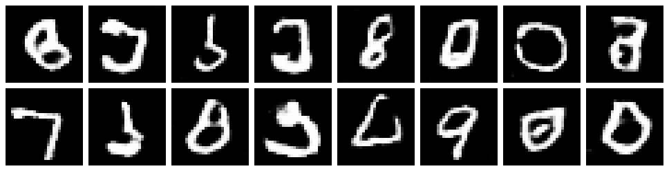
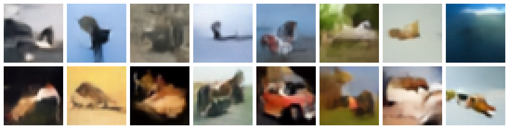
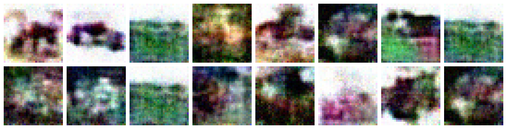

# applied-genai-api

FastAPI app for Applied Generative AI. It includes the class activity's text generator, Assignment 1 word embeddings, Assignment 2 image classification, Assignment 3 handwritten digit generation with a GAN, and Assignment 4 CIFAR-10 image generation with an energy-based model and a diffusion model.

## Run with Docker

```bash
git clone https://github.com/hiharryyim/applied-genai-api.git
cd applied-genai-api
docker build -t applied-genai-api:assignment4 .
docker run --rm -p 8001:80 applied-genai-api:assignment4
```

Open [http://127.0.0.1:8001/docs](http://127.0.0.1:8001/docs) to try the endpoints.

The first build downloads the dependencies, including the spaCy model. The trained weights of all models are included in the repository. The container runs inference on CPU.

## Classify an image

From the repository directory, run:

```bash
curl -X POST http://127.0.0.1:8001/classify \
  -F "file=@examples/test_image.png"
```

For the included CIFAR-10 test image, the model predicts `cat`. The response contains `class_id`, `class_name`, and `confidence`:

```json
{
  "class_id": 3,
  "class_name": "cat",
  "confidence": 0.7061259746551514
}
```

You can also upload a PNG or JPEG through `/docs`. Images are converted to RGB, resized to 64 x 64, and converted to tensors, using the same preprocessing as training. Unreadable image files return HTTP 400.

## Generate handwritten digits

Open [http://127.0.0.1:8001/generate_digits?num_samples=16&seed=42](http://127.0.0.1:8001/generate_digits?num_samples=16&seed=42) in a browser, or save the image with:

```bash
curl "http://127.0.0.1:8001/generate_digits?num_samples=16&seed=42" -o digits.png
```

The response is a PNG grid of new digits created by the GAN generator from random noise, with up to 8 digits per row. Each digit is 28 x 28 and is enlarged 4x for viewing.

`num_samples` sets how many digits to generate, from 1 to 64 (default 16). `seed` is optional: the same seed always returns the same digits, and without a seed every request returns new ones. Values outside these ranges return HTTP 422.

The request above returns:



The GAN is unconditional, so it cannot be asked for a specific digit.

## Generate CIFAR-10 images

Two endpoints return a PNG grid of new 32 x 32 color images, enlarged 4x for viewing:

```bash
curl "http://127.0.0.1:8001/generate_cifar_diffusion?num_samples=16&seed=42" -o diffusion.png
curl "http://127.0.0.1:8001/generate_cifar_ebm?num_samples=16&seed=42" -o ebm.png
```

Both take `num_samples` (1 to 64, default 16), `steps`, and an optional `seed` that works the same way as in `/generate_digits`. For `/generate_cifar_diffusion`, `steps` is the number of reverse diffusion steps (1 to 200, default 50). For `/generate_cifar_ebm`, it is the number of Langevin steps (1 to 256, default 60). With the default settings on CPU, 16 images take about 7 seconds from the diffusion model and about 1 second from the energy-based model.

The diffusion request above returns:



The energy-based request returns:



## Assignment 2 model

The PyTorch CNN follows the assignment architecture: two 3 x 3 convolutional layers with 16 and 32 filters, each followed by ReLU and 2 x 2 max pooling. The output is flattened to 8,192 features, followed by a 100-unit layer, ReLU, and a 10-unit output layer.

I trained it on [CIFAR-10 from Hugging Face](https://huggingface.co/datasets/uoft-cs/cifar10), using Adam with a learning rate of 0.001 for 10 epochs. Test accuracy was **65.82%** (6,582 of 10,000 images).

The checkpoint is saved in `app/models/cifar10_cnn.pth`. It contains the weights, class names, input size, and training metadata. The API loads it once at startup.

The ten classes are airplane, automobile, bird, cat, deer, dog, frog, horse, ship, and truck. Predictions are limited to these classes.

The model definition and training code are in [notebooks/Assignment2.ipynb](notebooks/Assignment2.ipynb). To run it, install `torch`, `torchvision`, `datasets`, `matplotlib`, and `tqdm` in the notebook's kernel environment.

## Assignment 3 model

The generator takes a 100-dim noise vector, maps it with a fully connected layer to 7 x 7 x 128, and upsamples it with two transposed convolutions (kernel 4, stride 2, padding 1): to 14 x 14 x 64 with BatchNorm and ReLU, then to 28 x 28 x 1 with Tanh. The discriminator mirrors it with two convolutions, 28 x 28 to 14 x 14 x 64 with LeakyReLU(0.2), then to 7 x 7 x 128 with BatchNorm and LeakyReLU(0.2), and a linear layer that outputs one real/fake score.

I trained it on the 60,000 MNIST training images, scaled to [-1, 1] to match the Tanh output. Training used binary cross-entropy (`BCEWithLogitsLoss`), Adam with a learning rate of 0.0002 and betas (0.5, 0.999) for each network, a batch size of 128, and 20 epochs. The final average losses were 0.2445 for the discriminator and 3.4731 for the generator.

Following the Module 6 class activity, the GAN code is in `helper_lib/`:

| File | Contents |
|---|---|
| `model.py` | `Generator`, `Discriminator`, and `get_model("GAN")` |
| `data_loader.py` | `get_data_loader`, which loads MNIST |
| `trainer.py` | `train_gan`, the training loop |
| `generator.py` | `generate_images` for the API and `generate_samples` for plotting |

Only the generator is needed to create images, so the checkpoint `app/models/mnist_gan_generator.pth` stores the generator weights and training metadata. The API loads it once at startup.

Training and sample outputs are in [notebooks/Assignment3.ipynb](notebooks/Assignment3.ipynb). To run it, install `torch`, `torchvision`, `matplotlib`, and `tqdm` in the notebook's kernel environment. MNIST is downloaded to `data/`, which is not committed.

## Assignment 4 models

Both models are trained on the 50,000 CIFAR-10 training images from Hugging Face, the same copy as in Assignment 2, with random horizontal flips and pixels scaled to [-1, 1]. Batch size is 128.

The energy model maps an image to a single energy score, low for real images. It has four stride-2 convolutions with 32, 64, 128 and 128 filters (32 x 32 down to 2 x 2), each followed by Swish, and two linear layers (512 to 128 to 1). Training follows the Module 8 class practical. Each step pushes the energy of real images down and the energy of model samples up, plus 0.1 times the squared energies to keep the scores small. The samples come from a replay buffer of 8,192 Langevin chains: each step continues 128 of them for 60 steps (step size 10, noise 0.005), and about 5% restart from uniform noise. I used Adam with a learning rate of 0.0001 and betas (0, 0.999), gradient clipping at 0.1, and 15 epochs.

New chains started from noise still look like noise after 256 Langevin steps, because the energy gradient with respect to the pixels is small, while the chains in the buffer have been updated many times during training. So the checkpoint `app/models/cifar10_ebm.pth` also stores the 2,048 buffer chains with the lowest energy as 8-bit images, and the API continues randomly chosen chains for `steps` more Langevin steps. These are the model's own samples, not training images.

The diffusion model is a UNet that predicts the noise in a noisy image. The noise variance goes through a sinusoidal embedding with 16 frequencies and is copied to every pixel. Three down blocks (32, 64 and 96 channels) halve the size from 32 x 32 to 4 x 4, two residual blocks with 128 channels work at 4 x 4, and three up blocks with skip connections return to 32 x 32. Each residual block uses GroupNorm and Swish. It uses the offset cosine schedule from the class practical, with the signal rate going from 0.95 to 0.02. Training uses the L1 loss between the predicted and the actual noise, AdamW with a learning rate of 0.001 and weight decay 0.0001, and 30 epochs; the final average loss was 0.1151. An exponential moving average of the weights (decay 0.999) is used for sampling, and `app/models/cifar10_diffusion.pth` stores only these averaged weights.

The new code is in `helper_lib/` next to the GAN:

| File | Contents |
|---|---|
| `model.py` | `EnergyModel`, `UNet`, `DiffusionModel`, `get_model("EBM")`, and `get_model("Diffusion")` |
| `data_loader.py` | `get_cifar10_loader` |
| `trainer.py` | `train_ebm` with the replay buffer, and `train_diffusion` |
| `generator.py` | `langevin_sample`, `generate_ebm_images`, and `generate_diffusion_images` |

Training and sample outputs are in [notebooks/Assignment4.ipynb](notebooks/Assignment4.ipynb). To run it, install `torch`, `torchvision`, `datasets`, `matplotlib`, and `tqdm` in the notebook's kernel environment. On an M4 Pro with MPS, an epoch took about 2 minutes for each model.

## Run locally

Requires [uv](https://docs.astral.sh/uv/).

```bash
uv sync
uv run fastapi dev app/main.py --port 8000
```

Local API docs: [http://127.0.0.1:8000/docs](http://127.0.0.1:8000/docs).

## Endpoints

| Method | Path | Body | Returns |
|---|---|---|---|
| GET | `/` | | `{"Hello": "World"}` |
| POST | `/generate` | `{"start_word": "the", "length": 12}` | generated text |
| POST | `/embedding` | `{"word": "apple"}` | 300-dim vector for the word |
| POST | `/similarity` | `{"word1": "apple", "word2": "orange"}` | cosine similarity |
| POST | `/classify` | image upload (`file`, multipart form) | class ID, name, and confidence |
| GET | `/generate_digits` | query: `num_samples=16&seed=42` (both optional) | PNG grid of generated digits |
| GET | `/generate_cifar_diffusion` | query: `num_samples=16&steps=50&seed=42` (all optional) | PNG grid of images from the diffusion model |
| GET | `/generate_cifar_ebm` | query: `num_samples=16&steps=60&seed=42` (all optional) | PNG grid of images from the energy-based model |

`/embedding` and `/similarity` return 404 if a word is not in the model's vocabulary.

Example:

```bash
curl -X POST http://127.0.0.1:8000/embedding \
  -H "Content-Type: application/json" \
  -d '{"word": "apple"}'
```
