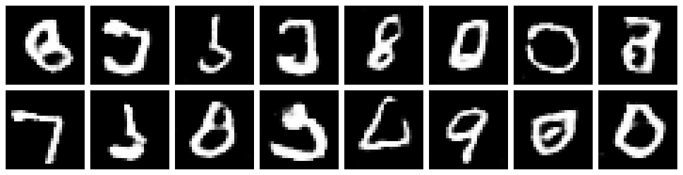

# applied-genai-api

FastAPI app for Applied Generative AI. It includes the class activity's text generator, Assignment 1 word embeddings, Assignment 2 image classification, and Assignment 3 handwritten digit generation with a GAN.

## Run with Docker

```bash
git clone https://github.com/hiharryyim/applied-genai-api.git
cd applied-genai-api
docker build -t applied-genai-api:assignment3 .
docker run --rm -p 8001:80 applied-genai-api:assignment3
```

Open [http://127.0.0.1:8001/docs](http://127.0.0.1:8001/docs) to try the endpoints.

The first build downloads the dependencies, including the spaCy model. The trained CNN and GAN weights are included in the repository. The container runs inference on CPU.

## Classify an image

From the repository directory, run:

```bash
curl -X POST http://127.0.0.1:8001/classify \
  -F "file=@examples/test_image.png"
```

For the included CIFAR-10 test image, the model predicts `cat`. The response contains `class_id`, `class_name`, and `confidence`:

```json
{
  "class_id": 3,
  "class_name": "cat",
  "confidence": 0.7061259746551514
}
```

You can also upload a PNG or JPEG through `/docs`. Images are converted to RGB, resized to 64 x 64, and converted to tensors, using the same preprocessing as training. Unreadable image files return HTTP 400.

## Generate handwritten digits

Open [http://127.0.0.1:8001/generate_digits?num_samples=16&seed=42](http://127.0.0.1:8001/generate_digits?num_samples=16&seed=42) in a browser, or save the image with:

```bash
curl "http://127.0.0.1:8001/generate_digits?num_samples=16&seed=42" -o digits.png
```

The response is a PNG grid of new digits created by the GAN generator from random noise, with up to 8 digits per row. Each digit is 28 x 28 and is enlarged 4x for viewing.

`num_samples` sets how many digits to generate, from 1 to 64 (default 16). `seed` is optional: the same seed always returns the same digits, and without a seed every request returns new ones. Values outside these ranges return HTTP 422.

The request above returns:



The GAN is unconditional, so it cannot be asked for a specific digit.

## Assignment 2 model

The PyTorch CNN follows the assignment architecture: two 3 x 3 convolutional layers with 16 and 32 filters, each followed by ReLU and 2 x 2 max pooling. The output is flattened to 8,192 features, followed by a 100-unit layer, ReLU, and a 10-unit output layer.

I trained it on [CIFAR-10 from Hugging Face](https://huggingface.co/datasets/uoft-cs/cifar10), using Adam with a learning rate of 0.001 for 10 epochs. Test accuracy was **65.82%** (6,582 of 10,000 images).

The checkpoint is saved in `app/models/cifar10_cnn.pth`. It contains the weights, class names, input size, and training metadata. The API loads it once at startup.

The ten classes are airplane, automobile, bird, cat, deer, dog, frog, horse, ship, and truck. Predictions are limited to these classes.

The model definition and training code are in [notebooks/Assignment2.ipynb](notebooks/Assignment2.ipynb). To run it, install `torch`, `torchvision`, `datasets`, `matplotlib`, and `tqdm` in the notebook's kernel environment.

## Assignment 3 model

The generator takes a 100-dim noise vector, maps it with a fully connected layer to 7 x 7 x 128, and upsamples it with two transposed convolutions (kernel 4, stride 2, padding 1): to 14 x 14 x 64 with BatchNorm and ReLU, then to 28 x 28 x 1 with Tanh. The discriminator mirrors it with two convolutions, 28 x 28 to 14 x 14 x 64 with LeakyReLU(0.2), then to 7 x 7 x 128 with BatchNorm and LeakyReLU(0.2), and a linear layer that outputs one real/fake score.

I trained it on the 60,000 MNIST training images, scaled to [-1, 1] to match the Tanh output. Training used binary cross-entropy (`BCEWithLogitsLoss`), Adam with a learning rate of 0.0002 and betas (0.5, 0.999) for each network, a batch size of 128, and 20 epochs. The final average losses were 0.2445 for the discriminator and 3.4731 for the generator.

Following the Module 6 class activity, the GAN code is in `helper_lib/`:

| File | Contents |
|---|---|
| `model.py` | `Generator`, `Discriminator`, and `get_model("GAN")` |
| `data_loader.py` | `get_data_loader`, which loads MNIST |
| `trainer.py` | `train_gan`, the training loop |
| `generator.py` | `generate_images` for the API and `generate_samples` for plotting |

Only the generator is needed to create images, so the checkpoint `app/models/mnist_gan_generator.pth` stores the generator weights and training metadata. The API loads it once at startup.

Training and sample outputs are in [notebooks/Assignment3.ipynb](notebooks/Assignment3.ipynb). To run it, install `torch`, `torchvision`, `matplotlib`, and `tqdm` in the notebook's kernel environment. MNIST is downloaded to `data/`, which is not committed.

## Run locally

Requires [uv](https://docs.astral.sh/uv/).

```bash
uv sync
uv run fastapi dev app/main.py --port 8000
```

Local API docs: [http://127.0.0.1:8000/docs](http://127.0.0.1:8000/docs).

## Endpoints

| Method | Path | Body | Returns |
|---|---|---|---|
| GET | `/` | | `{"Hello": "World"}` |
| POST | `/generate` | `{"start_word": "the", "length": 12}` | generated text |
| POST | `/embedding` | `{"word": "apple"}` | 300-dim vector for the word |
| POST | `/similarity` | `{"word1": "apple", "word2": "orange"}` | cosine similarity |
| POST | `/classify` | image upload (`file`, multipart form) | class ID, name, and confidence |
| GET | `/generate_digits` | query: `num_samples=16&seed=42` (both optional) | PNG grid of generated digits |

`/embedding` and `/similarity` return 404 if a word is not in the model's vocabulary.

Example:

```bash
curl -X POST http://127.0.0.1:8000/embedding \
  -H "Content-Type: application/json" \
  -d '{"word": "apple"}'
```
